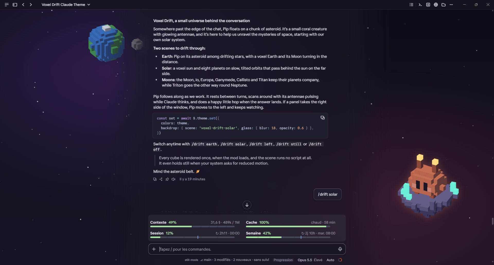
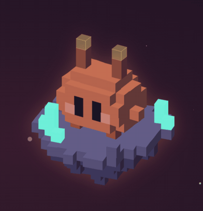
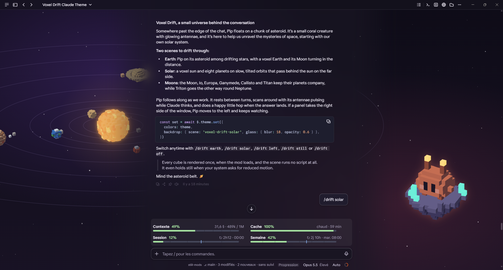
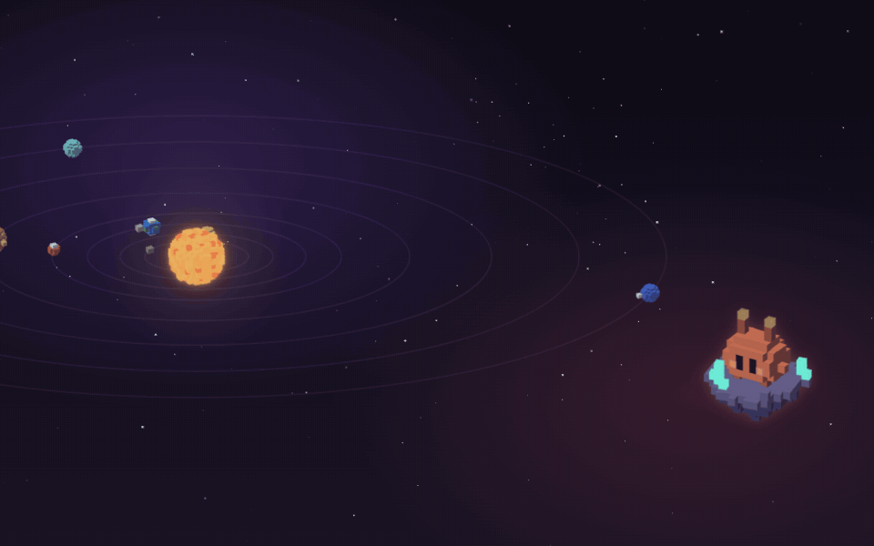

# Voxel Drift - Claude Desktop theme

[](https://buymeacoffee.com/stillgbx)

A 3D theme for the Claude desktop app, as a mod. Violet night in dark mode and lavender dawn in light mode, over voxel scenes where Pip, a small coral creature with glowing antennae, helps unravel the mysteries of space, starting with our own solar system.

Two scenes to drift through:

* **Earth**: Pip on a floating asteroid while stars drift past, with a voxel Earth and its Moon turning in the distance.
* **Solar**: the solar system, a voxel sun on the left and its eight planets on slow tilted orbits across the window, passing behind the sun on the far side. The main moons turn around their planets: the Moon, Io, Europa, Ganymede, Callisto, Titan, and Triton turning the other way round Neptune.

Pip follows Claude. Between turns it rests facing the conversation, blinks, glances around and sometimes does a full turn. While Claude works, it scans about with its antennae pulsing. When the answer is in, it hops and turns, pleased, then goes back to rest.

The scenes follow the app's light or dark mode and stop moving when the system asks for reduced motion.

### Earth



Pip at work while Claude answers, then pleased when the answer is in:



### Solar



The planets on their orbits, the moons around them, and the sun boiling softly:



## Install

In Claude Code, add this repository as a marketplace, then install the plugin from it:

```
/plugin marketplace add stillgbx/voxel-drift-claude
/plugin install voxel-drift@voxel-drift
```

In the Claude desktop app, you can also open *Settings > Plugins*, add the marketplace `stillgbx/voxel-drift-claude` with **Add**, then install **voxel-drift**.

The look shows in the desktop and mobile apps. The terminal and the editors don't draw themes.

## Use

```
/drift earth     Pip on its asteroid, the Earth in view (default)
/drift solar     the solar system
/drift right     Pip in the bottom right corner (default)
/drift left      Pip on the left, clear of a panel open on the right
/drift scene     the scene behind the conversation (default)
/drift still     the colors alone, without the scene
/drift off       back to the app's own look, for this session
```

Words combine (`/drift solar left`), and the choice is kept for the next sessions. The backdrop can't tell which panels are open, so Pip's side is yours to pick.

## How the 3D works

A backdrop is one SVG with no script, so the 3D runs once, when the mod loads. [`hooks/voxel.ts`](hooks/voxel.ts) is a small voxel renderer: it projects Pip at 32 angles, keeps only the faces the camera sees, shades them from one light and orders them back to front. Faces of one shade are merged into single paths, which keeps each scene under the 131,072 characters a backdrop may hold. A CSS `steps()` animation then plays Pip's frames like a flip book.

The planets and moons are rendered once each, and their orbits are CSS alone: a group squashed into an ellipse turns, and an inner group turns back so the planet stays upright. The sun boils by fading three sets of flares into its surface in turn.

Each of Pip's moods is its own drawing of the scene, and the mod draws the backdrop again when a turn starts or ends. Every looping animation is stamped with the time when it's drawn, so the planets and stars carry on where they were. The backdrop takes no pointer, neither hover nor clicks, so Pip follows Claude rather than the mouse.

## Files

* `hooks/voxel.ts`: the voxel renderer and the materials' colors.
* `hooks/pip.ts`: Pip, its asteroid, and what it does in each mood.
* `hooks/solar.ts`: the sun, the planets and their moons.
* `hooks/sky.ts`: the sky, the stars and the scene's clock.
* `hooks/scenes.ts`: the variants, each built once per mood and side.
* `hooks/colors.ts`: the app's colors, violet night and lavender dawn.
* `hooks/register.tsx`: sets the theme when a session starts, follows Claude's turns, draws the backdrop and answers `/drift`.
* `hooks/make-colors.js`: the design system's helper that turns a few colors into a whole theme. Don't edit it.

To draw another creature, edit the voxel cells in `pip()` in `hooks/pip.ts`.

## Developing

```bash
node --import ./scripts/ts-resolve.mjs scripts/preview.ts
```

This writes each scene to `Preview/<variant>.svg`, `Preview/index.html` (every variant in each of Pip's moods, in dark and light) and `Preview/frames.html` (each of Pip's frames, still), and prints each scene's size.

```bash
claude plugin validate .
```

```bash
claude plugin test .
```
